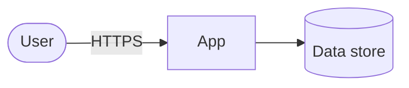

# Threat model — CourtRankRL

Living document. Update it when a new entry point, data store, external service is added. Last reviewed: _YYYY-MM-DD_.

## 1. System overview

_Describe the components and draw the data flow. Mark trust boundaries._

## 2. Assets

| Asset | Why it matters | Where it lives |
|---|---|---|
| API keys / secrets | Account takeover, spend | Secrets manager (see `secrets.md`) |
| User data | Privacy, legal | _…_ |

## 3. Verification target

OWASP ASVS 5.0 level: **L1** _(raise to L2 when the app stores user data or has accounts)_.

## 4. Threats

Use STRIDE for the classic part. Status: open / mitigated / accepted.

| ID | Threat | Component | Mitigation | Status |
|---|---|---|---|---|
| T1 | Leaked secret in repo or logs | repo, CI | Gitleaks pre-commit + CI, GitHub push protection; secrets manager | mitigated |
| T2 | Malicious or compromised dependency | build | Lockfiles, 7-day cooldown, OSV-Scanner, Dependabot malware alerts | mitigated |
| T3 | Compromised GitHub Action | CI | Actions pinned to SHAs, `permissions: {}` default, zizmor | mitigated |
| T4 | Unreviewed change reaches main | repo | PR-only ruleset, `ci-ok` required, ADR 0002 | accepted (solo) |

## 6. Accepted risks

| Risk | Why accepted | Revisit |
|---|---|---|
| No non-author review | Solo maintainer (ADR 0002) | When a second maintainer joins |
| Claude Code's `Read` deny rules for `.env*` and key files don't stop shell commands (`cat`, `python -c`) reading them | A `Bash(...)` deny list can't cover every way to read a file; Claude Code's sandbox is the real boundary | When the sandbox is enabled for this repo |
